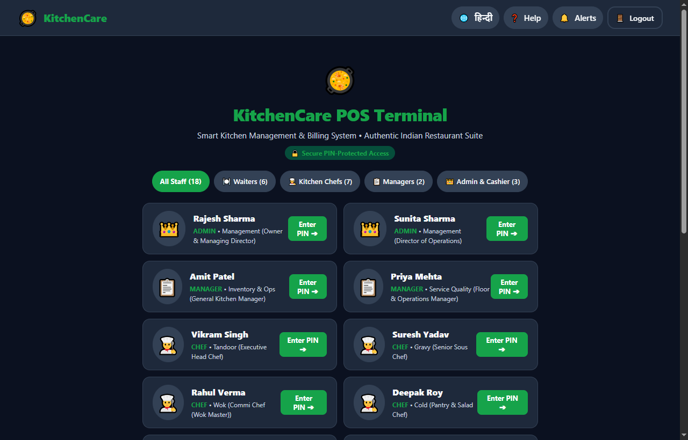
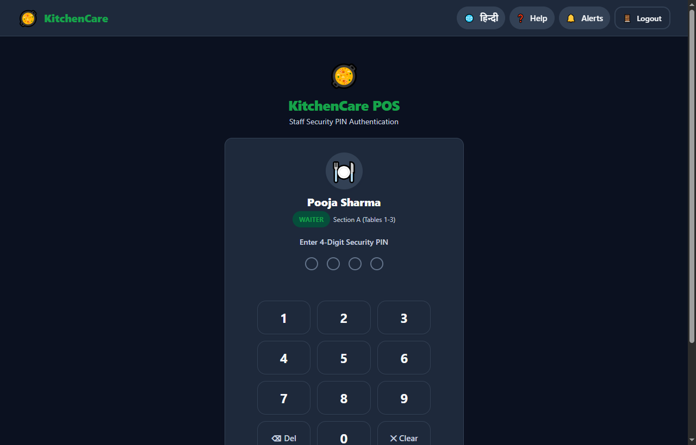
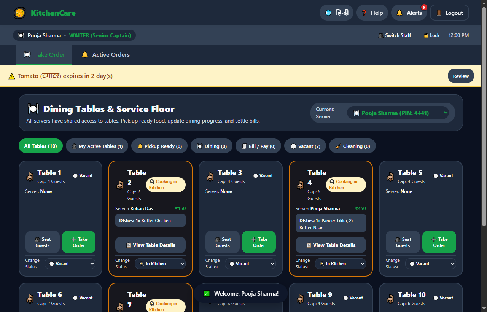
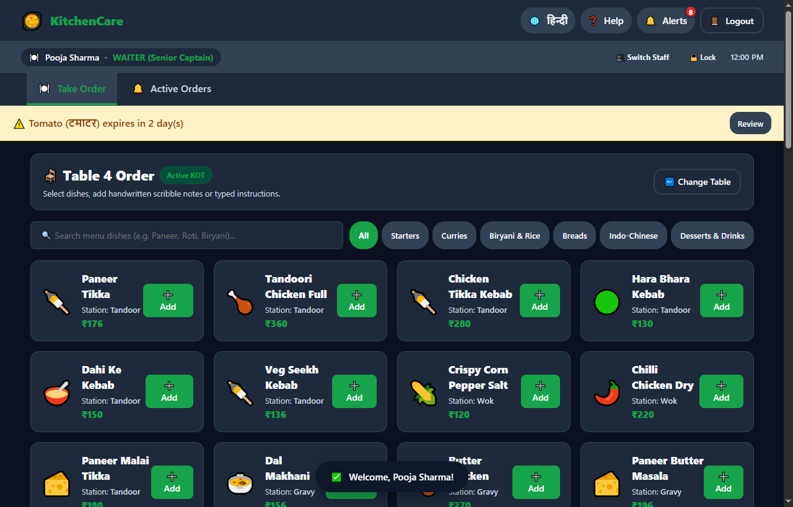
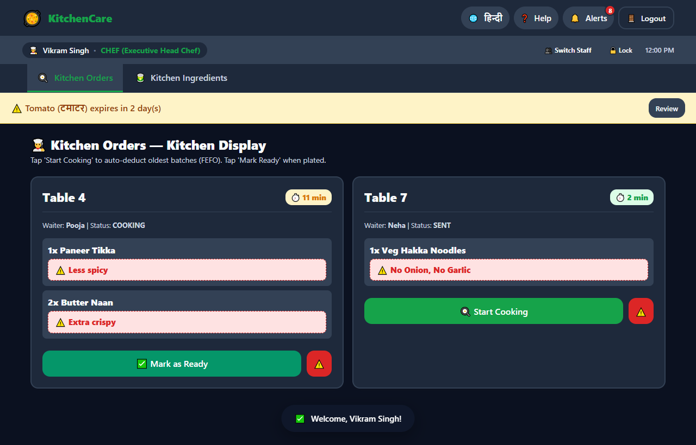
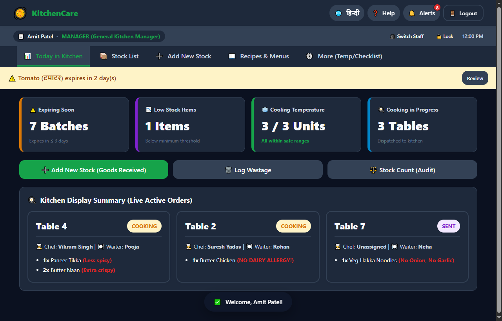
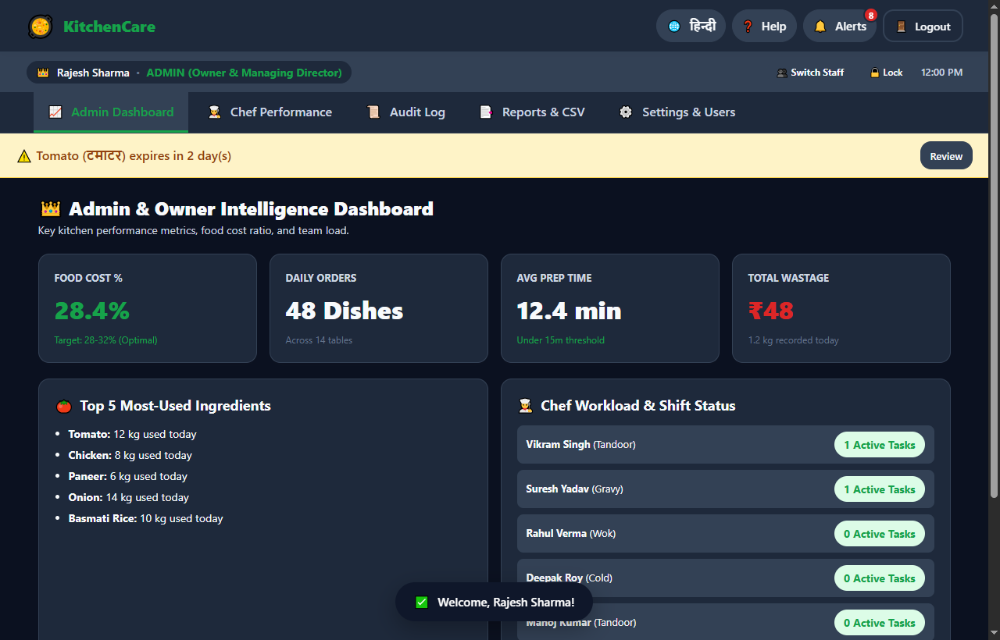
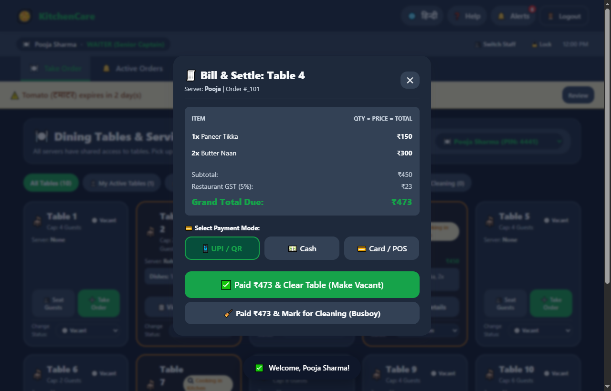

# 🥘 KitchenCare — Indian Restaurant Kitchen & Service Management

> A robust, fast, and offline-capable Kitchen Order Ticketing (KOT), Kitchen Display System (KDS), Multi-Waiter Floor Management, and PIN-Authenticated POS platform designed specifically for Indian restaurants.

---

## 📸 Screenshots & UI Walkthrough

### 1. 🔒 POS Staff Directory & PIN Authentication
Select any staff member from the roster and authenticate using their 4-digit security PIN. Features an on-screen touch numeric keypad, physical keyboard input, and masked PIN feedback with shake animations on invalid entries.

| POS Staff Roster | PIN Keypad Terminal |
|:---:|:---:|
|  |  |

---

### 2. 🍽️ Multi-Waiter Dining Floor & Menu Ordering
All servers share real-time visibility over tables. View live table statuses (`⚪ Vacant`, `👥 Seated`, `🍳 Cooking`, `🔔 Food Ready`, `🍽️ Dining`, `🧾 Billing`), pick up food from the pass queue, and take orders from an authentic 38-dish menu.

| Dining Floor & Table Lifecycle | 38-Dish Menu Catalog & Cart |
|:---:|:---:|
|  |  |

---

### 3. 👨‍🍳 Kitchen Display System (KDS) & Operations Management
Station chefs view tickets prioritized by waiting time with allergy banners, tap to view waiter handwritten scribble notes, and trigger automatic FEFO (First-Expired, First-Out) ingredient deduction upon cooking. Managers track batch expiries and fridge temperatures.

| Chef Kitchen Display System (KDS) | Kitchen Manager Dashboard |
|:---:|:---:|
|  |  |

---

### 4. 📈 Admin Analytics & Payment Settlement
Admins track live food cost %, revenue, and full tamper-proof audit trails. Cashiers settle bills across UPI / QR Code, Cash, and Card, instantly resetting tables back to vacant for new guests.

| Admin Dashboard & Cost Analytics | Payment Settlement & Receipt Modal |
|:---:|:---:|
|  |  |

---

## 👥 Staff Credentials Directory (All 18 Users & Passwords / PINs)

KitchenCare enforces PIN-based authentication. Use the credentials below to log into each role:

| Role | Staff Member | Staff ID | Security PIN / Password | Department / Station / Section |
|:---|:---|:---:|:---:|:---|
| **👑 Admin** | Rajesh Sharma | `u_admin` | `1111` | Owner & Managing Director |
| **👑 Admin** | Sunita Sharma | `u_admin2` | `1112` | Director of Operations |
| **📋 Manager** | Amit Patel | `u_mgr` | `2222` | General Kitchen Manager |
| **📋 Manager** | Priya Mehta | `u_mgr2` | `2223` | Floor & Operations Manager |
| **👨‍🍳 Chef** | Vikram Singh | `u_c1` | `3331` | Executive Head Chef (Tandoor Station) |
| **👨‍🍳 Chef** | Suresh Yadav | `u_c2` | `3332` | Senior Sous Chef (Gravy / Curry Station) |
| **👨‍🍳 Chef** | Rahul Verma | `u_c3` | `3333` | Commi Chef (Wok & Indo-Chinese) |
| **👨‍🍳 Chef** | Deepak Roy | `u_c4` | `3334` | Pantry & Salad Chef (Cold Station) |
| **👨‍🍳 Chef** | Manoj Kumar | `u_c5` | `3335` | Tandoor & Roti Master |
| **👩‍🍳 Chef** | Meera Joshi | `u_c6` | `3336` | Pastry & Halwai Chef (Desserts) |
| **👩‍🍳 Chef** | Anita Desai | `u_c7` | `3337` | South Indian & Breakfast Specialist |
| **🍽️ Waiter** | Pooja Sharma | `u_w1` | `4441` | Senior Captain (Section A — Tables 1–3) |
| **🍽️ Waiter** | Rohan Das | `u_w2` | `4442` | Floor Server (Section B — Tables 4–6) |
| **🍽️ Waiter** | Neha Gupta | `u_w3` | `4443` | Floor Server (Section C — Tables 7–9) |
| **🍽️ Waiter** | Rahul Nair | `u_w4` | `4444` | Terrace Server (Outdoor Terrace — Tables 10–12) |
| **🍽️ Waiter** | Simran Kaur | `u_w5` | `4445` | VIP Lounge Server (VIP Family Room) |
| **🍽️ Waiter** | Arjun Kapoor | `u_w6` | `4446` | Bar & Patio Server (Bar & Lounge) |
| **🧾 Cashier** | Kavita Rao | `u_cashier` | `5551` | Billing & Accounts Counter |

---

## 📖 Step-by-Step Instructions to Use the Website

### Step 1: Run the Server Locally
1. Clone the repository and navigate to the project directory:
   ```bash
   git clone https://github.com/Gauravmishra316/Kitchen-Care.git
   cd Kitchen-Care
   ```
2. Start the local server:
   ```bash
   npm start
   # or
   node server.js
   ```
3. Open your browser to **`http://localhost:5050/`**.

---

### Step 2: Staff Sign In & PIN Authentication
1. On the login screen, select your profile card (or filter by role tab: Waiters, Chefs, Managers, Admin).
2. Enter your **4-Digit Security PIN** using the on-screen keypad or physical number keys.
   - *Example:* For **Pooja Sharma (Waiter)**, enter `4441`.
   - *Example:* For **Vikram Singh (Head Chef)**, enter `3331`.
   - *Tip:* You can also expand the **"📋 Quick Staff Directory & PIN Reference Guide"** and click **"⚡ Test"** to sign in immediately.
3. If an incorrect PIN is entered, the keypad shakes with a red error alert. On success, you are routed directly to your role's primary workspace.

---

### Step 3: Waiter Service & Taking Table Orders
1. **Choose a Table:** On the dining floor, tap any table (e.g., **Table 1**).
2. **Add Dishes:** Browse the 38-dish catalog filtered by categories (**Starters**, **Curries**, **Biryani & Rice**, **Breads**, **Indo-Chinese**, **Desserts & Drinks**) or use the search bar.
3. **Handwritten Scribble Pad & Notes:**
   - Draw handwritten instructions on the digital canvas notepad (e.g. *"Serve naans piping hot"* or *"Extra lemon & onion"*).
   - Select dietary chips (`🌶️ Extra Spicy`, `🟢 Jain (No Onion/Garlic)`, `👶 Mild`, `🌾 Gluten-Free`, `⚡ Rush Order`).
4. **Custom Off-Menu Requests:** Enter custom items not on the standard menu with custom pricing.
5. Tap **"🚀 Send KOT to Kitchen"** — the order is dispatched immediately to the chef KDS.

---

### Step 4: Kitchen Chef Operations & KDS
1. Switch to Chef view (or log in as **Vikram Singh**, PIN `3331`).
2. Live orders appear with waiting timers and dietary badges.
3. Tap **"🍳 Start Cooking"**:
   - The system automatically triggers **FEFO (First-Expired, First-Out)** ingredient deduction from inventory.
4. Tap **"✍️ View Waiter Scribble"** to view high-resolution customer notes in a lightbox.
5. When plated, tap **"🔔 Mark Ready"** — this pushes the order to the pass pickup queue and plays an alert tone.

---

### Step 5: Food Pickup at Pass & Table Updates
1. Any waiter on duty sees the **"🔔 FOOD READY FOR PICKUP AT PASS"** banner.
2. Tap **"🍽️ Pick Up & Mark Served"** to deliver food to the table.
3. The table status automatically updates to `🍽️ Dining`.

---

### Step 6: Billing & Table Reset
1. When guests request the bill, tap **"🧾 Request Bill"** on the table card.
2. Tap **"💳 Settle & Clear Table"** to open the billing modal.
3. Review the itemized breakdown (Subtotal + 5% GST).
4. Choose the payment method: **📱 UPI / QR Code**, **💵 Cash**, or **💳 Card / POS**.
5. Tap **"✅ Complete Payment & Clear Table"**:
   - Payment is archived to sales reports.
   - Table status resets to `⚪ Vacant`, ready for the next guests.

---

### Step 7: Inventory & Batch Expiry Tracking (Manager)
1. Log in as **Amit Patel** (Manager, PIN `2222`).
2. Monitor **Today at a Glance**: batches expiring in ≤ 3 days (amber badge), expired batches (red badge), and low-stock alerts.
3. Tap **"➕ Add Stock"** when supplier deliveries arrive to log new batch numbers, quantities, costs, and expiry dates.
4. Log wastage with reason codes and record twice-daily fridge temperature checks for FSSAI compliance.

---

### Step 8: Admin Reports & Auditing
1. Log in as **Rajesh Sharma** (Admin, PIN `1111`).
2. View live Gross Sales, Net Profit, Food Cost %, and Chef Performance metrics.
3. Audit Log tracks every user action, PIN login, order dispatch, and payment with timestamps.
4. Export data to CSV for accounting.

---

## 🍲 38 Authentic Indian Dishes Catalog

* **🍢 Starters & Tandoor (11):** Paneer Tikka, Tandoori Chicken Full, Chicken Tikka Kebab, Hara Bhara Kebab, Dahi Ke Kebab, Veg Seekh Kebab, Crispy Corn Pepper Salt, Chilli Chicken Dry, Paneer Malai Tikka, etc.
* **🥘 Curries & Mains (10):** Dal Makhani, Butter Chicken, Paneer Butter Masala, Kadai Paneer, Palak Paneer, Chicken Tikka Masala, Mutton Rogan Josh, Malai Kofta, Pindi Chana Masala, Boiled Egg Masala.
* **🍚 Rice & Biryani (6):** Hyderabadi Chicken Dum Biryani, Lucknowi Veg Dum Biryani, Mutton Dum Biryani, Jeera Rice, Steamed Basmati Rice, Veg Fried Rice.
* **🫓 Tandoor Breads (5):** Tandoori Roti, Butter Naan, Garlic Naan, Laccha Paratha, Cheese Chilli Naan.
* **🥢 Indo-Chinese (5):** Veg Hakka Noodles, Chilli Paneer Gravy, Crispy Corn, Chilli Chicken, Veg Fried Rice.
* **🍧 Desserts & Beverages (6):** Boondi Raita, Green Fresh Salad, Gulab Jamun (2 pcs), Rasmalai (2 pcs), Punjabi Mango Lassi, Masala Kulhad Chai.

---

## 🛡️ Security & Privacy Notice
* **Zero Sensitive Data:** No hardcoded secret tokens, private API keys, or unhashed passwords.
* **Safe `.gitignore`:** Strict exclusion of `.env*`, `*.pem`, `*.key`, `*.cert`, `*.log`, credentials, and IDE cache.
* **Client-Side Storage Isolation:** All session tokens and kitchen master stores use sandboxed browser `localStorage` and `sessionStorage`.
* **Zero External Dependencies:** Built with pure vanilla HTML5, CSS3, JavaScript, and Node.js standard libraries for complete offline functionality and zero supply-chain attack vectors.

---

## 🛠️ Tech Stack
* **Frontend:** Modern Vanilla HTML5, CSS3 Variables, ES6 JavaScript, HTML5 Canvas API
* **Storage:** Browser `localStorage` with fail-safe auto-migrating data layer (`v2`)
* **Audio:** Web Audio API sound synthesis (zero external audio files)
* **Backend:** Node.js native `http` module (zero external dependencies)
* **License:** MIT
